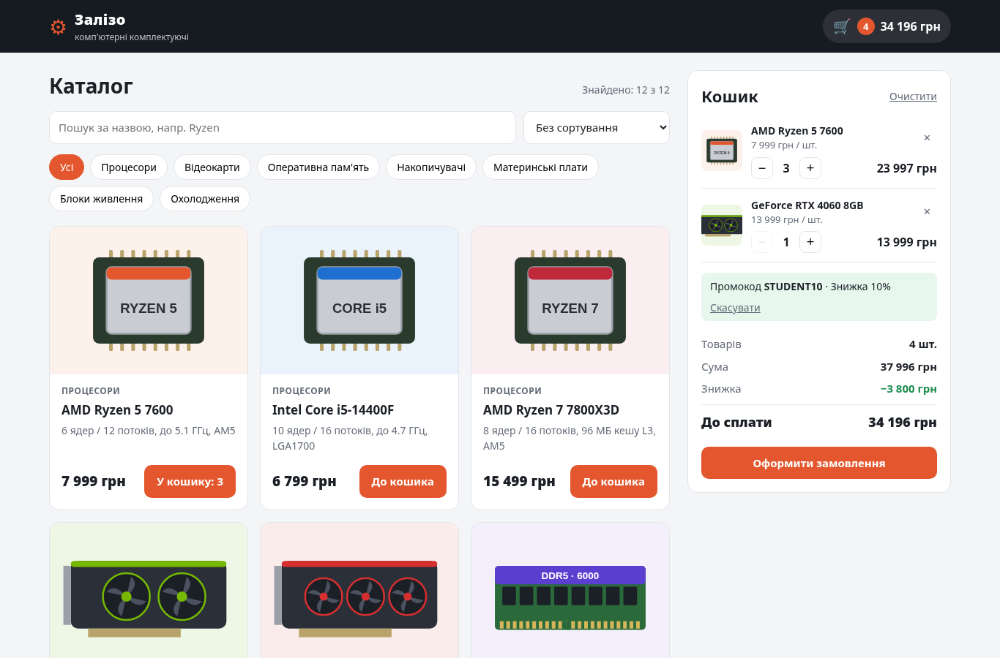

# Залізо — каталог комп'ютерних комплектуючих

Навчальний проєкт на **Vue.js 3 + Vite**: каталог товарів (процесори, відеокарти, пам'ять, накопичувачі тощо) з фільтром, пошуком, сортуванням і кошиком.

Інтерфейс реактивний: коли користувач змінює дані, сторінка оновлюється сама, без перезавантаження і без ручної роботи з DOM.



## Як запустити

Потрібен Node.js 22.18+ (або 24.12+).

```bash
npm install
npm run dev
```

Відкрийте адресу, яку покаже Vite (зазвичай http://localhost:5173).

Збірка для продакшну: `npm run build` (результат у теці `dist/`), перегляд збірки: `npm run preview`.

## Що реалізовано

| Вимога | Де в коді |
| --- | --- |
| Каталог із 12 товарів (назва, ціна, зображення, категорія), дані з JSON через `fetch` | `public/products.json`, `loadProducts()` у `src/App.vue` |
| Фільтр за категорією, пошук за назвою, сортування за ціною через `computed` | `categories`, `filteredProducts` у `src/App.vue` |
| Кошик: додати, змінити кількість (+ / −), видалити; лічильник у шапці і сума оновлюються одразу | `addToCart`, `increment`, `decrement`, `removeFromCart`, `cartCount`, `subtotal`, `total` |
| Власні компоненти: дані передаються через props, дії — через `emit` | `ProductCard.vue` (`add`), `CartItem.vue` (`increment`, `decrement`, `remove`), `CheckoutForm.vue` (`submit`, `cancel`), `AppHeader.vue` |
| Кошик зберігається в `localStorage` (`watch` з `deep: true`) | `watch(cart, …)` у `src/App.vue` |
| Окремі повідомлення «Кошик порожній» і «Нічого не знайдено» | шаблон `src/App.vue` |
| Адаптивна верстка без горизонтальної прокрутки на телефоні (перевірено на ширині 320 px) | `src/assets/main.css`, стилі компонентів |
| **Додатково:** оформлення замовлення з перевіркою полів | `src/components/CheckoutForm.vue` |
| **Додатково:** сортування за ціною | `sortOrder` у `src/App.vue` |
| **Додатково:** промокоди | `PROMO_CODES`, `discount` у `src/App.vue` |

### Промокоди для перевірки

- `STUDENT10` — знижка 10 %
- `ZALIZO500` — мінус 500 ₴ при замовленні від 5 000 ₴

## Структура

```
public/
  products.json        — дані каталогу
  img/                 — SVG-зображення товарів
src/
  App.vue              — стан застосунку: каталог, фільтри, кошик, промокод
  components/
    AppHeader.vue      — шапка з лічильником кошика
    ProductCard.vue    — картка товару
    CartItem.vue       — позиція в кошику
    CheckoutForm.vue   — форма оформлення замовлення
  utils/format.js      — форматування ціни в гривнях
  assets/main.css      — глобальні стилі
```
